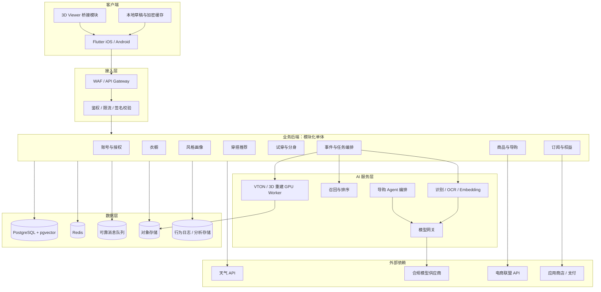
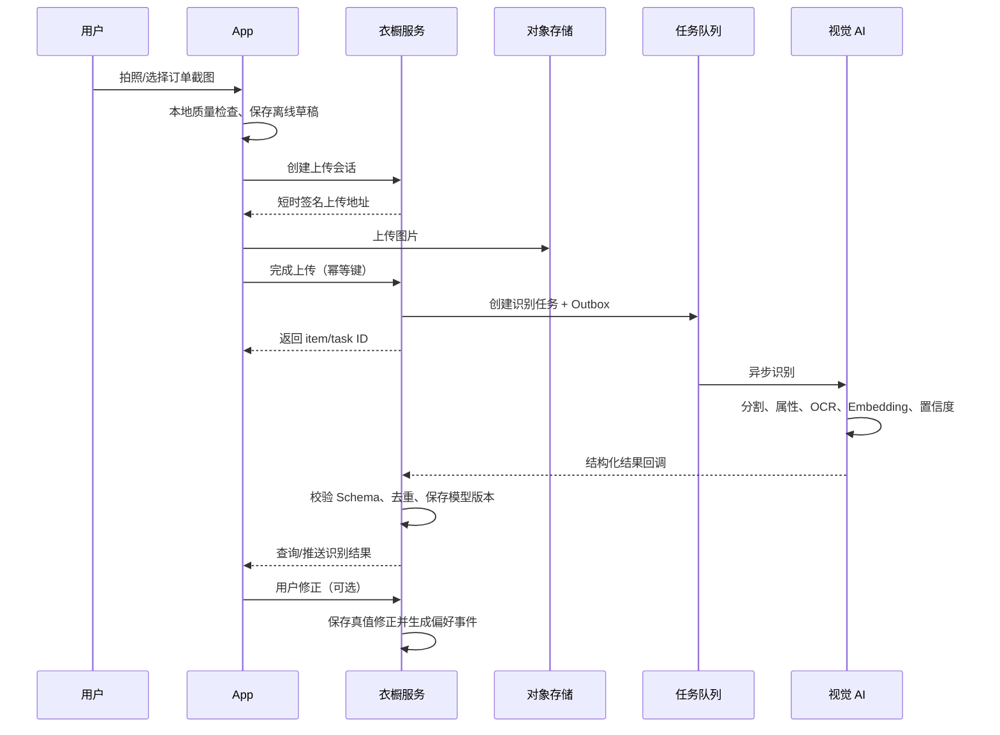
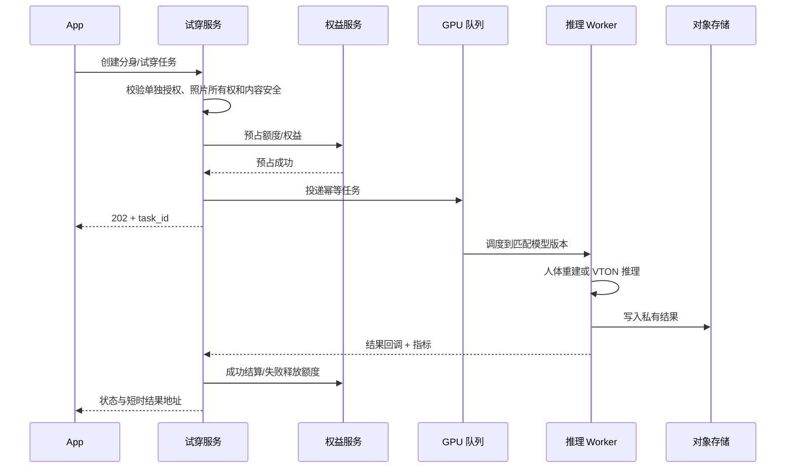
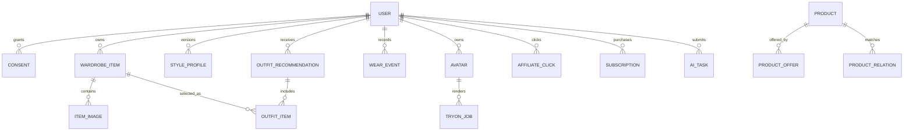

# AI 智能导购 App 技术落地系分文档

> 文档版本：V1.1
> 需求基线：《AI 智能导购 App 产品需求文档》V1.0（2026.05）
> 开源调研：《GitHub 开源技术调研与完整 App 落地建议》V1.0（2026.05）
> 文档性质：技术方案建议稿，供产品、客户端、服务端、算法、测试、安全与运维联合评审
> 说明：本文中的技术选型、性能门槛和排期为建议基线；标记“待确认”的事项需在对应阶段启动前完成决策。

---

## 1. 执行摘要

### 1.1 对产品本质的理解

本产品不是单纯的聊天机器人、衣橱记录工具或试穿工具，而是一个以个人衣橱为数据底座、以穿搭决策为核心闭环的个人决策系统：

```text
衣物数字化 → 用户偏好建模 → 场景约束下的搭配推荐 → 试穿/确认 → 穿着与反馈沉淀
                                      ↓
                         衣橱缺口识别 → 商品决策 → 购买/劝退
```

技术设计应优先保证以下三点：

1. **推荐结果真实可执行**：只能推荐用户当前拥有且可穿的衣物，或来自可核验商品数据；大模型不得凭空创造衣物、价格和库存。
2. **个人数据形成复利**：录入修正、点赞、跳过、试穿、实穿和购买反馈均需结构化沉淀，并带模型版本，支持画像更新与效果评估。
3. **用户信任不可被商业化破坏**：商品匹配度与佣金隔离，推广内容独立标识，用户照片与分身默认高等级保护，删除必须覆盖关联派生数据。

### 1.2 推荐实施路径

- **MVP（第 1～3 个月）**：Flutter App + 模块化单体后端；完成拍照/截图入库、衣橱管理、风格画像 V1、天气与场景推荐、反馈闭环和基础 2D 试穿验证。
- **V1（第 4～6 个月）**：在专项技术验证通过后上线数字分身和多角度试穿；引入 Pro 订阅、额度控制、GPU 弹性推理。若高保真 3D 不达标，则发布“数字分身 + 多视角效果图”，不得将其包装为真实尺寸试穿。
- **V2（第 7～12 个月）**：接入官方电商联盟 API，完成商品归一、同款/相似款区分、价格快照、搭配缺口推荐、CPS 归因；无稳定数据来源的平台不上线实时比价承诺。

### 1.3 十项核心技术决策

| 编号 | 建议决策 | 原因 |
|---|---|---|
| TD-01 | MVP 使用 Flutter，3D 查看器通过独立桥接模块接入 | 控制双端成本，同时保留替换高性能渲染引擎的空间 |
| TD-02 | 业务后端采用模块化单体，AI 推理独立为 Python 服务 | 避免过早微服务化，同时隔离 GPU、模型依赖和弹性伸缩 |
| TD-03 | PostgreSQL + pgvector 作为 MVP 主存储与向量检索 | 降低存储和运维组件数量，支持事务、JSON 和向量查询 |
| TD-04 | 识别、试穿、分身生成均异步任务化，业务请求不等待 GPU | 隔离超时和抖动，支持重试、限流、取消与成本核算 |
| TD-05 | 推荐采用“规则过滤 → 候选生成 → 学习排序 → LLM 解释” | 保证可执行性、可解释性和可控成本 |
| TD-06 | LLM 不直接访问数据库，只通过白名单工具获取最小必要数据 | 降低幻觉、越权和提示词注入风险 |
| TD-07 | 2D VTON 与真正 3D 试穿分轨验证，不混用技术承诺 | 单张 2D 换装图天然不具备可自由旋转的 3D 一致性 |
| TD-08 | 所有 AI 结果带置信度、模型版本和来源，低置信字段允许为空 | 避免“零填写”演变为“自动填错” |
| TD-09 | 商品推荐排序禁止使用佣金字段，推广走独立广告槽位 | 从产品机制上保证中立性 |
| TD-10 | 照片、分身和穿搭行为按高敏感级数据设计，授权、训练、分享分别同意 | 满足最小必要、可撤回和可删除要求 |

---

## 2. 需求拆解与边界校准

### 2.1 用户价值与技术能力映射

| 用户问题 | 产品能力 | 技术核心 | 最小验证指标 |
|---|---|---|---|
| 不知道衣橱里有什么 | 拍照、截图、链接和语音入库 | 图像分割、多模态属性抽取、OCR、去重、离线草稿 | 录入成功率、单件耗时、字段准确率、修正率 |
| 不知道今天穿什么 | 今日穿搭、单品替换、穿搭日历 | 天气/场景约束、搭配候选、个性化排序、重复穿着控制 | 推荐查看率、采纳率、决策时长、周留存 |
| 不知道风格是什么 | 风格 DNA 与衣橱报告 | 可解释特征统计、Embedding、聚类、反馈更新 | 报告生成率、报告认可度、分享率 |
| 网购上身效果不确定 | 数字分身、虚拟试穿 | 人体重建、服装生成/重建、多视角渲染、GPU 调度 | 分身“像我”评分、试穿满意度、任务成功率、单次成本 |
| 不知道是否值得买 | 搭配潜力、同款比价、历史价格、购买跳转 | 商品归一、图文检索、价格快照、搭配评分、CPS 归因 | 分析完成率、劝退/购买决策率、点击率、转化率 |

### 2.2 PRD 中需要校准的八处落地口径

| 主题 | PRD 目标 | 技术校准建议 |
|---|---|---|
| 入驻与画像 | 3 分钟拍 5 件后获得风格报告；衣橱 ≥20 件生成初版画像 | 5 件仅生成“风格预览”，明确样本不足；20 件后生成完整画像。分身创建改为可跳过步骤，避免授权压力导致流失 |
| 10 秒入库 | 单件录入平均 ≤10 秒，且支持离线拍摄 | 拆成“本地保存 ≤1 秒”和“联网后识别 P95 ≤10 秒”；离线期间显示待识别，不伪装识别完成 |
| 零字段填写 | 无需必填字段即可入库 | 仅品类等最小字段由系统推断；品牌、材质不确定时置空，不用 LLM 猜测补齐；用户可后续修正 |
| 2D 与 3D | 基于 2D 图片换装，同时支持 360°、走姿 | 2D VTON 只能输出指定视角图像。真正可旋转试穿需 3D 服装资产/重建，或采用多视角生成并声明视觉参考属性 |
| 试穿性能 | 分身 ≤3 分钟、单件 ≤10 秒 | 统一按 P95 统计，并拆分排队、推理、下载时间；冷 GPU 环境不承诺 10 秒，上线前需专项压测 |
| 画像更新 | 每周更新，行为持续学习 | 在线行为即时进入特征表；排序模型可小步更新；报告和聚类每周批处理，避免画像频繁跳变 |
| 历史低价 | 心动单品分析包含历史低价 | 仅展示系统已积累的价格历史；新接入商品无数据时显示“暂无历史价格”，不得从当前价反推 |
| 阶段优先级 | AI 买手部分标为 P0，但 roadmap 在 V2 | 以 roadmap 为阶段基线：MVP 不做跨平台实时比价；架构预留商品域和分享解析入口 |

### 2.3 3D 试穿必须明确的承诺边界

“看起来像”“尺码合适”“真实垂坠”是三种不同能力，不能相互替代：

- **2D 换装**：适合验证用户是否喜欢风格与颜色，不包含真实尺码和物理合体结论。
- **3D 数字分身 + 多视角生成**：可查看多个角度，但视角间可能不一致，仍属于视觉参考。
- **3D 服装仿真**：需要服装版型、面料、尺寸和物理参数，才可讨论垂坠、松紧与尺码建议；普通电商单图通常不具备这些输入。

因此 V1 页面必须固定展示“效果仅供视觉参考，不代表真实尺码与上身效果”，不得输出“保证合身”。尺码建议若后续上线，应作为独立模型和独立合规评估项目。

---

## 3. 阶段范围与验收出口

### 3.1 MVP：验证衣橱与穿搭决策闭环

**范围内**

- 手机号/第三方登录、账号注销、隐私授权与撤回。
- 单件拍照、订单截图批量导入、离线草稿、识别结果编辑、衣物归档/在洗状态。
- 衣物分类筛选、基础去重、穿着记录。
- 入驻问卷、5 件风格预览、20 件完整画像、周报更新。
- 城市级天气、手动场景选择、3 套穿搭、换一换、推荐理由、点赞/跳过/采纳。
- 基础 2D 试穿 PoC 或小流量功能，不作为核心留存达成的唯一前提。
- 事件埋点、模型调用台账、崩溃和性能监控、基础管理后台。

**范围外**

- 高保真 3D 分身、360° 试穿、走姿。
- 跨平台实时比价、CPS、自动商品链接全网抓取。
- 语音录入、衣橱全景多件分割（可作为技术预研，不阻塞主流程）。
- 社区、品牌 SaaS、数据洞察交易。

**MVP 出口条件**

1. 核心链路可用：注册 → 拍照 → 自动入库 → 生成推荐 → 采纳/反馈 → 穿搭日历。
2. 品类准确率、颜色准确率在冻结测试集达到 PRD 目标，且样本分布有代表性。
3. 衣橱柜内推荐不存在不可穿衣物、跨用户数据和不存在的单品 ID。
4. 次周留存、推荐采纳率、录入放弃率具备可靠埋点，可与 1 万种子用户目标对照。
5. 完成照片删除、账号注销、授权撤回和第三方模型数据策略验证。

### 3.2 V1：试穿与订阅

- 数字分身创建、用户校准、重建和删除。
- 试穿任务、多角度查看、效果对比、生成内容标识。
- 3D 查看器性能适配和结果缓存。
- Pro 订阅、服务端权益校验、免费额度、恢复购买、退款/取消同步。
- GPU 成本看板、模型 AB 分流、质量评估集。

**上线硬门槛**：效果盲评、任务成功率、P95 时延、单任务 GPU 成本和中端机 30 FPS 均达到评审阈值；不达标时保留 2D 方案，不带病扩张。

### 3.3 V2：跨平台买手

- 官方联盟 API 优先，按平台建立独立适配器与字段映射。
- 标准化商品、SKU、平台报价、价格快照、相似商品关系。
- 分享链接解析、搭配潜力、缺口推荐、购买/劝退反馈。
- CPS 链接签名、点击与订单回调对账、佣金报表。
- 商业推广标识和推荐中立性审计。

---

## 4. 总体技术架构

### 4.1 架构图



### 4.2 部署建议

- MVP 使用云厂商托管容器、托管 PostgreSQL/Redis/消息队列和对象存储，避免一开始维护完整 Kubernetes 集群。
- 业务服务至少双实例跨可用区部署；AI GPU Worker 与业务资源池隔离，按队列深度扩缩容。
- 生产、预发、测试环境和对象存储 Bucket 完全隔离；禁止生产照片进入开发环境。
- 中国用户数据与模型处理链路默认境内闭环。境外模型供应商只有在数据出境评估、单独同意和法务评审完成后才允许处理相关数据。
- Terraform 等 IaC 工具可作为工程实践选项，但不构成产品依赖；所有环境配置和密钥由云密钥管理系统管理。

### 4.3 服务拆分演进

MVP 不拆微服务，但模块之间只允许通过应用服务和领域事件交互，不跨模块直接改表。出现以下信号再拆分：

- GPU/推荐模块需要独立扩缩容或独立发布。
- 商品数据抓取的故障影响核心衣橱链路。
- 团队边界稳定、接口契约成熟，且运维能力足够。

优先独立的是 AI 推理和异步 Worker；账号、衣橱、推荐事务仍保持单体，避免分布式事务拖慢迭代。

---

## 5. 客户端技术方案

### 5.1 技术选型

建议采用 Flutter + 原生能力插件：

- 页面与业务：Flutter，按 `presentation / application / domain / data` 分层。
- 网络：统一 API Client，处理访问令牌刷新、请求 ID、幂等键、错误码与灰度配置。
- 本地存储：数据库保存离线衣物草稿和任务状态；敏感缓存加密，不长期保存原始人像照片。
- 原生桥接：系统分享、相册/相机、日历授权、应用内购买、推送、3D Viewer。
- 3D Viewer：V1 可先验证 Three.js WebView + GLB；通过原生桥传递短时下载凭证和手势事件。若帧率、发热或内存不达标，再替换原生 SceneKit/Filament 或 Unity，业务层不变。

### 5.2 关键客户端设计

**离线录入**

1. 拍照后立即生成 `local_item_id`，压缩图片并保存本地草稿。
2. 网络恢复后申请上传凭证，断点续传或失败重试。
3. 上传完成转为服务端 `item_id`，通过本地与服务端 ID 映射避免重复入库。
4. App 被杀后可恢复；用户退出账号时清理本账号敏感缓存。

**任务体验**

- 识别、分身、试穿统一采用任务卡片：`等待上传 → 排队 → 处理中 → 成功/失败/已取消`。
- 前台轮询使用指数退避，后台恢复时主动拉取；推送只作为提醒，不作为唯一状态来源。
- 失败区分“可重试”“照片质量不足”“内容不合规”“额度不足”“供应商故障”，给出可执行提示。

**分享与安全**

- 分享商品链接仅传用户主动选择的 URL；读取剪贴板必须由明确操作触发。
- 分享风格报告默认不包含身材数据、原始人像、精确位置和购买明细。
- 3D 模型和试穿结果通过短时签名 URL 下载；WebView 禁止任意导航和未授权桥方法。

### 5.3 性能预算

| 项目 | 建议预算 |
|---|---|
| 冷启动到首页可交互 | 中端机 P75 ≤2.5 秒，持续监测 P95 |
| 普通页面首屏 | 缓存可用时 ≤1 秒；网络数据并行加载 |
| 图片 | 缩略图、列表图、详情图分级；WebP/HEIF 按端适配 |
| 3D 模型 | GLB + Draco/Meshopt，纹理 KTX2；按机型分级下载 |
| 3D 交互 | 目标 ≥30 FPS；设置纹理和内存上限，防止 OOM |
| 电量与发热 | 连续旋转 5 分钟专项测试，后台停止渲染 |

---

## 6. 服务端领域设计

### 6.1 模块职责

| 模块 | 核心职责 | 主要依赖 |
|---|---|---|
| 账号与授权 | 登录、账号状态、授权版本、撤回、注销、数据导出 | 身份服务、审计日志 |
| 衣橱 | 图片上传、衣物 CRUD、识别草稿、状态、穿着记录、去重 | 对象存储、AI 任务 |
| 风格画像 | 显式偏好、行为聚合、风格向量、报告版本 | 特征任务、向量库 |
| 穿搭推荐 | 天气/场景约束、候选搭配、排序、替换、反馈 | 衣橱、画像、天气、排序服务 |
| 试穿与分身 | 授权校验、任务编排、结果、额度、模型版本 | GPU Worker、对象存储、权益 |
| 商品与导购 | 商品归一、报价、相似款、搭配分析、CPS 点击与订单 | 平台适配器、检索 |
| 订阅与权益 | 商品配置、收据校验、权益、额度和退款状态 | 商店/支付回调 |
| 事件与分析 | 事件接入、任务状态、推荐曝光、指标口径 | 分析存储 |
| 管理后台 | 内容审核、任务重试、模型灰度、平台数据质量、客服删除 | 管理权限与审计 |

### 6.2 一致性与可靠性

- 衣物创建、任务创建和事件写入采用本地事务 + Transactional Outbox，避免“数据库成功、消息丢失”。
- 所有上传完成、AI 回调、平台订单回调和支付回调必须支持幂等。
- 任务以 `(task_id, attempt)` 记录执行次数；回调校验当前状态，迟到的旧结果不得覆盖新结果。
- 用户重复点击生成时，通过幂等键和短锁复用进行中的任务，防止重复扣费和重复 GPU 消耗。
- 删除采用软删除标记 + 异步物理清理；清理对象包括原图、缩略图、向量、分身网格、纹理、试穿结果、缓存和供应商侧可删除副本。
- 核心写操作保留审计日志，但审计日志不保存原始照片、完整提示词中的隐私内容或签名 URL。

### 6.3 任务状态机

```text
AI 任务：DRAFT → UPLOADING → QUEUED → RUNNING → SUCCEEDED
                    │           │         │
                    └───────────┴─────────┴→ FAILED_RETRYABLE → QUEUED
                                              │
                                              └→ FAILED_FINAL
任意有效状态 → CANCELLED（已开始推理的任务可能无法撤回供应商费用）
```

重试仅适用于超时、限流、临时网络错误；输入质量、内容审核和参数错误不得盲目重试。每个任务最多自动重试 2 次，超过后进入人工/客服可重试流程。

---

## 7. 核心链路详细设计

### 7.1 拍照与截图入库



**处理流水线**

1. 图片旋转纠正、清晰度/曝光/遮挡检查。
2. 单件检测；多件图先分割，低置信分割结果允许用户框选。
3. 品类使用受控分类树，颜色使用标准色板 + 原始 RGB/Lab 值。
4. 材质、品牌、风格等字段输出 `value + confidence + evidence + model_version`；无可靠证据则为空。
5. 订单截图使用 OCR 提取标题、订单时间、平台等，再解析商品属性；价格属于历史购买信息，不作为当前售价。
6. 用感知哈希、图像向量和用户内品类进行重复候选检测；高相似时让用户选择合并，不直接误删。
7. 用户修正优先作为该衣物的最终值；用于训练必须另有可撤回的模型优化授权。

**降级策略**

- 多模态模型失败时，以基础分类模型先入库，其他字段待补。
- 无法识别时仍允许保存图片并进入“待完善”，不阻塞衣橱。
- 识别接口超时后异步完成，App 不重复上传相同内容。

### 7.2 风格 DNA 画像

画像由可解释统计和语义向量共同组成，不让 LLM 直接凭空归纳：

```text
显式问卷 + 衣物属性 + 穿着记录 + 反馈行为
       ↓
特征聚合（频次、近因、多样性、负反馈、置信度）
       ↓
风格向量 / 聚类 + 色彩与版型分布 + 衣橱结构规则
       ↓
风格标签和证据 → LLM 文案组织 → 结构化校验 → 报告
```

设计原则：

- 标签占比表示当前模型下的相对偏好，不宣称为客观人格测量。
- 每个结论必须能追溯到证据，例如“近 90 天保存的 12 套搭配中，8 套包含低饱和中性色”。
- 新用户冷启动以问卷为主；行为较少时提高问卷先验权重，避免一两次点击改变整体画像。
- 显式偏好高于隐式行为；用户可关闭某类行为用于画像。
- 保存 `profile_version、feature_window、model_version、generated_at`，报告历史可复现。
- 每周全量更新，重大显式修改可触发即时增量更新。

### 7.3 今日穿搭推荐

**推荐步骤**

1. **上下文获取**：用户城市、天气、场景、日程类型、衣物状态、近 3 天穿着历史。
2. **硬约束过滤**：在洗/归档/破损衣物排除；天气和场景规则过滤；保暖与防水要求按规则校验。
3. **候选生成**：按“上装 + 下装/连衣裙 + 外套 + 鞋 + 可选配饰”模板组合，利用兼容矩阵和向量近邻限制搜索空间。
4. **排序**：综合风格契合、色彩协调、场合适配、天气适配、新颖度、衣物利用率和历史反馈。
5. **多样性重排**：3 套结果需有风格或核心单品差异，避免只替换一件配饰。
6. **解释生成**：LLM 只接收已确定的事实字段，输出固定 Schema；程序复核衣物 ID、温度、场景和理由证据。
7. **反馈闭环**：曝光、查看、替换、跳过、收藏、实穿分别记录，不把曝光当喜好。

建议排序函数：

```text
score = w1 * style_fit
      + w2 * color_compatibility
      + w3 * occasion_fit
      + w4 * weather_fit
      + w5 * novelty
      + w6 * wardrobe_utilization
      - w7 * repetition_penalty
      - w8 * negative_feedback_penalty
```

权重先由规则配置和人工评测确定，有足够数据后再训练 Learning-to-Rank 模型。商业化字段不得进入该函数。

**单品替换**：固定其他单品，仅重算目标槽位候选；返回时保留原搭配 ID 和替换原因，便于衡量用户对局部建议的接受度。

**降级**：天气不可用时让用户手动选择温度/天气；画像不足时使用问卷和通用搭配规则；LLM 不可用时使用模板理由，推荐主链路不中断。

### 7.4 数字分身与试穿



**分身流水线**：授权校验 → 图片质量和姿态检查 → 人体关键点/体型估计 → 参数化人体拟合 → 用户身高体重校准 → 面部/发型/肤色处理 → 网格与纹理输出 → 私有存储。

**两条试穿路线**

| 路线 | 输入 | 优点 | 局限 | 建议用途 |
|---|---|---|---|---|
| 单图 2D/多视角生成 | 人像或分身视角 + 商品图 | 覆盖商品广、无需完整服装资产 | 细节、背面和体型可能失真 | MVP/V1 视觉效果验证 |
| 3D 服装资产 + 人体网格 | GLB/版型/面料等 | 可自由旋转，一致性和交互更可控 | 资产制作成本高，单图自动重建难 | 品牌合作、重点 SKU、高保真版本 |

- 模型许可需单独审查。SMPL/SMPL-X、开源 VTON 权重和训练数据的“可研究使用”不等于可商用。
- 任务结果必须记录人体模型、服装模型、随机种子、参数和代码版本，支持问题复现。
- 缓存键至少包含 `avatar_version + garment_version + pose + view + quality + model_version`；用户撤回或删除后缓存同步失效。
- 多用户共享相同商品图时可复用中间特征，但不得复用包含他人身体或人像的结果。
- 分享图片需有可见生成标识，文件元数据按适用法规加入隐式标识；私密原图不默认进入公开分享链路。

### 7.5 跨平台商品与 AI 买手

**数据接入原则**

1. 官方开放平台/联盟 API 优先，品牌合作数据其次。
2. 爬虫不是默认可依赖能力；每个数据源需审查服务条款、robots、访问频率、数据使用范围和跳转政策。
3. 平台字段和回调能力不一致，通过适配器转换，不让平台差异泄漏到核心模型。
4. 价格、库存和优惠券带 `observed_at` 与来源；超过时效必须显示“可能已变化”。

**商品归一**

```text
平台原始商品 → 标题/图片清洗 → 品牌/品类/款号/属性抽取
             → 候选召回 → 同款判别 → 人工抽检 → 标准商品与 SKU
```

- **同款**：品牌、款号或高置信多属性一致，且具体到可比较 SKU；仅图片相似不能称同款。
- **相似款**：风格或外观相近，单独标识，不与同款价格混排。
- **历史价格**：来自系统定时快照和联盟返回，不补造历史。
- **搭配潜力**：计算可与衣橱多少有效单品组成满足约束的搭配，并展示具体搭配证据；不是 LLM 随意给分。

**中立性实现**

- 排序服务输入中删除 `commission_rate、settlement_amount` 等字段。
- CPS 链接仅在用户点击购买后生成，不回写商品匹配分。
- 商业推广使用独立 `placement_type=SPONSORED`、独立审计和明确页面标识。
- 定期抽样比较不同佣金档位的曝光分布，发现商业字段泄漏可阻断发布。

**Agent 权限**

- 商品标题、详情和用户输入均视为不可信数据，不能覆盖系统指令。
- 工具只允许查询天气、本人衣橱、商品、创建试穿任务等白名单操作。
- Agent 无自动下单、自动扣款和修改授权权限。
- 工具返回经过 Schema 校验和长度限制；跨用户检索在数据层强制隔离，而非依赖 Prompt。

---

## 8. AI 工程与模型治理

### 8.1 模型网关

模型网关统一负责：

- 按任务选择模型：分类/OCR 小模型优先，复杂解释才使用高阶模型。
- 供应商超时、限流、熔断和可兼容任务降级；不同模型输出必须经过统一 Schema。
- Token、图片张数、GPU 秒数、缓存命中、排队时长和单用户成本台账。
- Prompt、模型、参数和输出结构版本管理。
- 敏感字段脱敏、供应商数据保留策略检查和禁止训练配置校验。
- 灰度、AB 测试、质量评估与快速回滚。

不得为了“多供应商容灾”把敏感人像自动转发到未批准供应商。涉及照片的故障转移只能发生在同等隐私与地域等级的供应商之间。

### 8.2 结构化输出与质量控制

衣橱识别建议输出：

```json
{
  "category": {"value": "OUTERWEAR", "confidence": 0.96},
  "primary_color": {"value": "OFF_WHITE", "confidence": 0.88},
  "material": {"value": null, "confidence": 0.0},
  "brand": {"value": null, "confidence": 0.0},
  "style_tags": [{"value": "MINIMAL", "confidence": 0.76}],
  "evidence": {"category": "long_lapel_and_front_opening"},
  "model_version": "wardrobe-v1.x"
}
```

所有生成结果先过 JSON Schema、受控枚举和业务约束校验，再落库。推荐理由中的每个衣物 ID 必须属于当前用户，温度必须来自已查询天气，商品价必须来自有效报价快照。

### 8.3 离线评估体系

| 能力 | 数据集 | 核心指标 | 补充指标 |
|---|---|---|---|
| 品类识别 | 人工标注、覆盖光照/背景/折叠/遮挡 | Top-1 Accuracy ≥90% | 各类别 F1、置信度校准 |
| 颜色识别 | 标准色板 + 人工复核 | 达标口径下 ≥85% | 多色衣物、色差与光源分层 |
| 分割 | 单件、多件和复杂背景 | mIoU/检测召回 | 错拆率、漏拆率 |
| 推荐 | 人工搭配集 + 历史反馈 | 约束违规率、采纳率、NDCG | 多样性、重复率、解释事实一致率 |
| 分身 | 多体型/肤色/发型/姿态盲评 | “像我”认可度、任务成功率 | 不同人群分组表现 |
| 试穿 | 多品类和多视角测试集 | 身份保持、服装细节、视觉质量 | 多视角一致性、伪影、时延与成本 |
| 商品同款 | 人工确认同款/相似/非同款 | Precision/Recall | 同款误并率优先控制 |

准确率验收需冻结测试集、定义标签口径和抽样方法，并报告样本量与置信区间；不能用线上随机抽样的一次平均值替代。

### 8.4 成本控制

PRD 中约 ¥7.8/活跃用户/月只能作为待验证假设，实际成本需按压测结果重新计算：

```text
月成本 = Σ（各模型调用次数 × 单次 Token/图片成本）
       + GPU 秒数 × GPU 秒价 / 有效利用率
       + 对象存储与下行流量
       + 队列、监控及第三方 API
       + 失败重试和无效任务成本
```

控制手段：图片尺寸分级、识别结果缓存、推荐解释模板化、批量画像任务、GPU 自动启停、免费额度、低清预览/高清付费、重复结果复用、异常用户限流。不得通过降低敏感数据保护换成本。

---

## 9. 数据模型设计

### 9.1 核心实体关系



### 9.2 主要表与关键字段

| 表 | 关键字段 | 说明 |
|---|---|---|
| `users` | `id, status, region, timezone, created_at, deleted_at` | 不在主表堆叠画像 JSON |
| `consents` | `id, user_id, type, policy_version, action, occurred_at` | 追加式授权记录；类型含人像处理、日历、训练优化等 |
| `wardrobe_items` | `id, user_id, source, category, colors_json, material, brand, style_tags, status, confidence_json, model_version, created_at, deleted_at` | `status` 含可用/在洗/归档；保存用户最终修正值 |
| `item_images` | `id, item_id, object_key, kind, sha256, width, height, created_at` | 原图/缩略图/分割图分开，私有 Bucket |
| `wear_events` | `id, user_id, item_id/outfit_id, worn_on, source, created_at` | 同一天同一搭配去重 |
| `style_profiles` | `id, user_id, version, vector_ref, features_json, report_json, model_version, generated_at` | 历史版本不可被周报覆盖 |
| `outfit_recommendations` | `id, user_id, context_json, algorithm_version, status, created_at` | 保存天气和场景快照以复现 |
| `outfit_items` | `recommendation_id, item_id, slot, rank, score, reason_json` | 快照或版本引用防止衣物变更后无法解释 |
| `recommendation_feedback` | `id, recommendation_id, user_id, action, target_item_id, created_at` | 曝光、采纳、替换、跳过分开 |
| `avatars` | `id, user_id, status, model_object_key, measurements_ciphertext, model_version, created_at, deleted_at` | 身材数据加密；模型 URL 不直接公开 |
| `tryon_jobs` | `id, user_id, avatar_id, garment_type, garment_ref, mode, status, result_key, error_code, model_version, gpu_ms, created_at` | 商品或衣橱单品用类型化引用 |
| `products` | `id, normalized_title, brand, category, attributes_json, image_embedding, created_at` | 跨平台标准商品 |
| `product_offers` | `id, product_id, platform, platform_product_id, sku_json, price, list_price, stock_status, observed_at, source_url` | 报价时效化，优惠券单独记录 |
| `price_snapshots` | `offer_id, price, promotion_json, observed_at` | 追加写，支持历史曲线 |
| `product_relations` | `source_product_id, target_product_id, relation_type, confidence, reviewer_status` | 同款/相似款严格区分 |
| `affiliate_clicks` | `id, user_id, offer_id, tracking_id, clicked_at, signed_url_ref` | 不将佣金传回排序模型 |
| `affiliate_orders` | `platform_order_id, tracking_id, status, amount, commission, occurred_at, raw_payload_ref` | 平台订单号幂等；原始回调受控保存 |
| `subscriptions` | `id, user_id, channel, product_id, status, expires_at, original_transaction_id` | 服务端验单，不信任客户端“已支付” |
| `entitlement_ledger` | `id, user_id, benefit_type, delta, reason, task_id, created_at` | 额度预占、结算、返还可审计 |
| `ai_tasks` | `id, user_id, type, status, idempotency_key, attempt, provider, cost, created_at, updated_at` | 统一任务查询和成本归集 |
| `outbox_events` | `id, aggregate_type, aggregate_id, event_type, payload, published_at` | 可靠异步发布 |

### 9.3 数据访问与生命周期

- 所有个人数据查询必须带 `user_id`；ORM 层提供默认租户作用域，跨用户后台查询使用独立权限与审计。
- pgvector 的 `metadata.user_id` 不是充分安全边界，查询需同时由业务层强制过滤，并定期做越权测试。
- Redis Key 包含用户 ID、数据版本和过期时间；注销后主动清理。
- 对象存储全部私有，使用短时签名 URL；对象 Key 随机化但不以“难猜”替代访问控制。
- 建议默认保留策略：原始识别照片由用户控制；失败任务临时文件 7 天清理；过期签名 URL 分钟级失效；备份在既定周期滚动删除。最终期限由产品与法务确认并在隐私政策中一致披露。
- 账号注销进入短暂可撤回期（若产品需要）后执行删除；删除完成生成不可抵赖审计记录，备份随轮换周期清除。

---

## 10. API 与事件契约

### 10.1 API 约定

- 基础路径 `/api/v1`，写请求支持 `Idempotency-Key`，全链路带 `X-Request-Id`。
- 访问令牌短期有效，刷新令牌轮换；服务端校验账号和授权状态。
- 统一错误结构：`code、message、retryable、request_id、details`；不向客户端暴露堆栈和供应商密钥。
- 列表使用游标分页；时间统一 UTC 存储，客户端按用户时区展示。
- 异步创建返回 HTTP 202 和任务查询地址；回调需签名、时间戳和防重放校验。

### 10.2 核心 API 草案

| 方法 | 路径 | 用途 |
|---|---|---|
| POST | `/uploads` | 创建私有图片上传会话 |
| POST | `/wardrobe/items` | 从已上传图片创建衣物与识别任务 |
| GET | `/wardrobe/items?cursor=&category=&status=` | 衣橱筛选 |
| PATCH | `/wardrobe/items/{id}` | 修正属性、在洗/归档状态 |
| DELETE | `/wardrobe/items/{id}` | 删除衣物及派生数据 |
| POST | `/wardrobe/imports/screenshots` | 批量截图解析 |
| GET | `/style-profile/current` | 当前画像和证据 |
| POST | `/style-profile/regenerate` | 满足条件时重建画像 |
| POST | `/outfits/recommendations` | 按天气/场景生成 3 套搭配 |
| POST | `/outfits/recommendations/{id}/replace` | 单品级替换 |
| POST | `/outfits/recommendations/{id}/feedback` | 曝光后反馈、采纳、跳过 |
| POST | `/wear-events` | 记录实穿 |
| POST | `/avatars` | 创建数字分身任务 |
| DELETE | `/avatars/{id}` | 删除分身及所有派生结果 |
| POST | `/tryon-jobs` | 创建试穿任务并预占额度 |
| GET | `/tasks/{id}` | 查询统一任务状态 |
| POST | `/shopping/analyses` | 分析外部分享商品（V2） |
| GET | `/products/{id}/offers` | 同款报价与相似款分栏（V2） |
| POST | `/affiliate-clicks` | 生成带归因的购买跳转（V2） |
| POST | `/subscriptions/verify` | 服务端验证购买并刷新权益 |
| GET | `/me/export` | 创建个人数据导出任务 |
| DELETE | `/me` | 注销账号 |

任务响应示例：

```json
{
  "task_id": "01J...",
  "type": "TRYON",
  "status": "QUEUED",
  "retryable": false,
  "result": null,
  "links": {"self": "/api/v1/tasks/01J..."},
  "request_id": "req_..."
}
```

### 10.3 领域事件

建议事件：`WardrobeItemRecognized、WardrobeItemCorrected、OutfitRecommended、OutfitAdopted、WearRecorded、StyleProfileGenerated、AvatarCreated、TryOnCompleted、ConsentRevoked、AccountDeletionRequested、PriceObserved、AffiliateOrderUpdated`。

事件仅携带必要 ID 和版本，不携带原始图片、完整人像或敏感正文。消费者按事件 ID 去重，允许乱序时依据聚合版本丢弃旧事件。

---

## 11. 非功能需求与 SLO

### 11.1 性能与可用性

| 指标 | 建议验收口径 |
|---|---|
| 核心 API 可用性 | 月可用性 ≥99.9%，不含提前公告的维护窗口 |
| 普通读 API | 服务端 P95 ≤500ms、P99 ≤1.5s |
| 普通写 API | 服务端 P95 ≤800ms；异步 AI 不计入推理时长 |
| 拍照本地保存 | 中端机 P95 ≤1 秒生成离线草稿 |
| 联网单件识别 | 上传完成后 P95 ≤10 秒；单独统计排队和模型时延 |
| 3 套穿搭推荐 | P95 首屏 ≤5 秒；LLM 失败时用模板理由降级 |
| 分身生成 | 技术目标 P95 ≤180 秒，排队与推理分别披露 |
| 单件试穿 | 技术目标 P95 ≤10 秒；须以指定分辨率、热 GPU 和并发条件验收 |
| 3D 交互 | 指定中端测试机 ≥30 FPS，无持续内存增长 |
| 任务最终成功率 | 识别 ≥99%（合法且质量合格输入）；试穿按灰度实测设门槛 |

所有性能指标需写明设备、网络、图片大小、输出分辨率、并发和是否包含排队，避免“实验室平均值”被误当线上承诺。

### 11.2 容量与容灾

- 以 DAU、早晨推荐峰值、每人日均识别数、试穿并发和 GPU 推理时长建立容量模型；早高峰重点压测推荐与天气缓存。
- 天气按城市与短时窗口缓存，避免每个用户请求都调用外部 API。
- 对象存储启用版本/跨区策略按数据敏感度评审；数据库每日全量 + 持续增量备份，定期恢复演练。
- 建议 MVP `RPO ≤15 分钟、RTO ≤4 小时`；V1 商业化后根据损失评估提高。
- 外部模型故障时，识别和试穿进入排队/稍后重试，穿搭推荐回退规则解释；不阻塞用户查看和编辑衣橱。

### 11.3 可观测性

- 指标：API RED、任务队列深度、任务年龄、成功率、重试率、GPU 利用率、显存、模型时延、Token、单任务成本、缓存命中。
- 日志：结构化并带 `request_id/task_id/user_hash/model_version`；默认不记录照片、签名 URL、完整个人文本。
- Trace：覆盖客户端请求 ID、网关、业务模块、消息、AI 服务和供应商调用。
- 告警：错误率、P95、积压、配额消耗、单用户异常调用、删除任务失败、支付回调积压。
- 看板：业务漏斗与 AI 质量/成本分开，支持按版本、机型、供应商和用户群分层。

---

## 12. 安全、隐私与合规设计

> 本节是工程设计基线，不替代法务意见；具体适用范围需由法务结合发布地区、数据流和供应商合同确认。

### 12.1 数据分级

| 等级 | 数据示例 | 主要控制 |
|---|---|---|
| S4 高敏感 | 人像原图、面部/身体模型、身材参数、日历详情 | 单独同意、端到端访问控制、KMS 加密、短时效 URL、严格审计 |
| S3 敏感 | 衣橱照片、穿着历史、位置城市、购买记录、风格画像 | 最小收集、按用户隔离、可导出/删除、限制分析用途 |
| S2 内部 | 脱敏模型指标、聚合运营数据 | 权限控制、防重识别、保留期 |
| S1 公开 | 主动分享的报告和带标识试穿图 | 分享前预览、可撤回、内容安全 |

### 12.2 同意与最小化

- 基本衣橱识别、数字分身、人脸/身体处理、模型优化、日历读取、社交分享分别授权，不能捆绑成一个不可拆分的同意。
- 不授权日历时仍可手动选择场景；不创建分身时仍可使用衣橱和推荐。
- 天气优先使用用户手动选择的城市或粗略位置，非必要不获取持续精确位置。
- 默认不把个人照片用于通用模型训练；参与优化需明确、可撤回的选择，并建立撤回后的样本剔除机制。
- 年龄门槛和青少年保护按产品承诺执行；检测到不适宜内容时停止生成并提供申诉入口。

### 12.3 技术控制

- 传输 TLS，敏感字段和对象使用 KMS 管理的密钥加密；密钥不写入代码、日志或客户端。
- 服务端管理权限采用 SSO/MFA、最小权限和短时授权；生产人像默认不可被运维直接浏览。
- 供应商合同明确数据用途、保留、删除、训练禁用、分包方和地域；上线前完成数据流清单。
- 生成式内容按适用法规添加显式/隐式标识；算法备案、安全评估或其他义务由法务按实际服务形态判断。
- 含佣金或品牌推广内容清晰标识；推荐中立性既是产品原则，也是安全审计项。
- 建立越权、批量爬取、恶意上传、提示词注入、模型反推和 WebView 桥攻击测试。
- 账号注销、撤回同意、删除分身分别提供真实可执行的 API 和后台工单兜底，并验证第三方副本处理结果。

---

## 13. 埋点与指标体系

### 13.1 北极星指标口径

建议将“周活跃穿搭决策次数”定义为：

```text
每周有效决策总数 / 当周活跃用户数
```

有效决策仅包括：

- 对今日穿搭执行“确认穿这套”或记录实穿。
- 对心动商品明确选择“准备购买”或“放弃购买/被劝退”。

同一用户、同一对象在 5 分钟内重复点击只计一次；纯曝光、滑动、试穿生成和购买跳转不算决策。用户是否活跃采用统一 WAU 定义，并在数据字典中冻结。

### 13.2 核心事件

| 事件 | 必要属性 | 用途 |
|---|---|---|
| `wardrobe_capture_created` | source、offline、image_count | 录入漏斗 |
| `wardrobe_recognition_completed` | duration、success、model_version、error_code | 识别质量和时延 |
| `wardrobe_item_corrected` | field、old/new 类别（不记敏感原文） | 字段错误率 |
| `outfit_recommendation_shown` | recommendation_id、scene、algorithm_version | 曝光基准 |
| `outfit_decision_made` | decision、recommendation_id、latency | 北极星指标 |
| `outfit_item_replaced` | slot、old/new item_id | 局部推荐质量 |
| `style_report_viewed/shared` | profile_version、sample_size_bucket | 画像价值与裂变 |
| `tryon_completed` | mode、duration、gpu_ms、model_version、cost | 试穿性能与成本 |
| `tryon_rated` | rating、identity_score、garment_score | 试穿满意度 |
| `shopping_decision_made` | product_id、decision、reason | 买手决策价值 |
| `affiliate_click/order` | tracking_id、platform、status | CPS 漏斗和对账 |
| `consent_changed/deletion_requested` | type、status | 合规审计 |

所有实验指标同时观察质量、时延和成本，禁止只优化点击率而损害中立性。

---

## 14. 测试与验收方案

### 14.1 工程测试

- 单元测试：搭配硬约束、状态机、权益台账、商品同款规则、幂等、删除编排。
- 集成测试：PostgreSQL/Redis/MQ/对象存储真实测试实例，覆盖 Outbox 和回调重试。
- 契约测试：客户端 API、AI Schema、天气、支付和电商平台适配器；使用脱敏夹具。
- E2E：离线上传恢复、识别失败重试、推荐降级、试穿取消、额度返还、恢复购买、注销删除。
- 安全测试：水平越权、签名 URL 泄漏、重放、恶意文件、Prompt 注入、管理后台权限。
- 性能测试：早高峰推荐、批量截图导入、GPU 排队、冷启动、对象下载和中端机 3D 内存。
- 容灾测试：模型超时、天气不可用、平台回调重复、Worker 崩溃、支付回调延迟。

### 14.2 AI 专项验收

1. 冻结版本化测试集，训练/调参集与验收集隔离。
2. 品类、颜色、分割按 PRD 指标验收，同时检查不同拍摄条件和人群分组。
3. 推荐先做离线约束校验，再人工盲评，最后在线 AB；线上反馈不能替代安全规则。
4. 试穿采用双盲评分，分别评价“像本人”“像原衣服”“多视角一致”“整体自然”，避免一个总分掩盖问题。
5. 模型升级必须可回滚，且新旧版本同时保留结果复现信息。

### 14.3 核心场景验收清单

| 场景 | 通过标准 |
|---|---|
| 无网拍 3 件衣服后恢复网络 | 草稿不丢、不重复，联网后自动识别并通知 |
| AI 无法判断品牌和材质 | 字段为空，衣物仍入库，无虚构内容 |
| 衣物在洗或最近 3 天已穿 | 默认不推荐；若允许用户覆盖需明确记录 |
| 天气或 LLM 故障 | 推荐仍返回或清晰降级，理由不编造天气 |
| 用户撤回人像授权 | 不再创建任务，按规则删除/停用分身和派生结果 |
| 试穿 Worker 失败 | 不重复扣额度，任务可重试，用户看到明确状态 |
| 两个平台只有外观相似 | 标为相似款，不进入“同款最低价”比较 |
| 高佣金与低佣金商品 | 在相同匹配特征下排序不受佣金影响 |
| 账号注销 | 缓存、向量、原图、分身、试穿结果及供应商副本进入可追踪删除流程 |

---

## 15. 里程碑、团队与交付物

### 15.1 建议排期

| 阶段 | 时间 | 技术重点 | 出口 |
|---|---|---|---|
| Phase 0：验证与奠基 | 第 1～2 周 | 数据流、分类体系、模型 PoC、平台 API 调研、3D 路线验证、埋点字典 | 技术风险清单和可测基线通过评审 |
| MVP-A：衣橱闭环 | 第 3～6 周 | 账号授权、上传、识别、编辑、离线草稿、后台 | 拍照/截图入库稳定可用 |
| MVP-B：推荐闭环 | 第 7～10 周 | 画像、天气、候选排序、替换、实穿反馈、分析看板 | 核心决策闭环 E2E 通过 |
| MVP-C：灰度发布 | 第 11～12 周 | 压测、安全、隐私删除、模型评估、种子用户灰度 | 达到质量门槛并具备回滚能力 |
| V1：试穿商业化 | 第 4～6 月 | 分身、试穿、3D 查看器、GPU 调度、订阅权益 | 质量/时延/成本/帧率四项门槛通过 |
| V2：AI 买手 | 第 7～12 月 | 平台适配、商品归一、价格历史、CPS、合规审计 | 至少 2 个官方数据源跑通归因闭环 |

Phase 0 不另加在 PRD 三个月之外，而是 MVP 的前两周。3D 预研应从 Phase 0 并行开始，避免第 4 个月才发现路线不可行。

### 15.2 团队建议

MVP 建议 8～11 人的跨职能团队：产品 1、设计 1、Flutter 2、后端 2～3、视觉/推荐算法 1～2、测试 1、DevOps/安全按 0.5～1 人投入。V1 另增 3D/图形算法和客户端渲染能力；V2 增加商品数据与平台对接工程力量。

### 15.3 每阶段必备交付物

- 架构决策记录（ADR）与外部依赖清单。
- 数据字典、分类体系、API 契约和事件字典。
- 模型卡、测试集版本、评估报告、成本报告和回滚方案。
- 数据流图、授权矩阵、删除链路验证和供应商处理清单。
- 压测报告、灰度方案、告警看板、运行手册和故障预案。

---

## 16. 风险、触发器与预案

| 风险 | 早期信号/触发器 | 技术预案 |
|---|---|---|
| 衣橱识别错误导致不信任 | 关键字段修正率高、入库后删除多 | 低置信置空、快速修正、按类别回退基础模型，不盲目生成 |
| 推荐“像模板” | 3 套相似、采纳率低 | 加强多样性与负反馈；先优化候选和特征，再换大模型 |
| 试穿不像人/不像衣服 | 盲评分低、多视角不一致 | 分路线降级，限制支持品类和姿态，增加用户校准，不承诺尺码 |
| GPU 成本失控 | 单任务成本或失败重试率超预算 | 限额、分辨率分级、缓存、动态排队、暂停低价值任务 |
| 电商 API 不可用 | 字段缺失、限流、政策变化 | 多平台适配、快照时效提示；无数据则不展示实时比价 |
| 同款误并 | 比价投诉、品牌款号冲突 | 提高同款阈值，转相似款并引入人工抽检 |
| 敏感数据泄漏 | 异常下载、日志出现 URL、越权测试失败 | 立即吊销凭证、封锁访问、启动安全响应和数据删除/通知流程 |
| 第三方模型不稳定 | 超时、格式错误、内容漂移 | Schema 校验、熔断、同级供应商降级、模板理由、版本回滚 |
| 过早架构复杂化 | 本地开发依赖过多、发布慢 | 保持模块化单体和托管组件，以真实扩展信号拆服务 |
| 指标“虚高” | 用曝光/点击代替决策 | 冻结指标口径，去重并做埋点审计 |

---

## 17. 待产品与技术共同决策的问题

### 17.1 阻塞 MVP 的决策

1. 首发地区、应用市场、登录方式及账号注销冷静期。
2. 衣物分类树、颜色标准、衣物状态和“最近 3 天重复”的用户覆盖规则。
3. 5 件风格预览与 20 件完整报告的具体展示差异。
4. 首批模型供应商、数据处理地域、保留周期及是否允许训练。
5. MVP 的 2D 试穿究竟是全量功能、实验功能还是仅内部 PoC。
6. 免费范围与早期额度，即使订阅 V1 上线也需先设调用防滥用阈值。

### 17.2 阻塞 V1 的决策

1. V1 承诺是“2D 换装”“多视角效果”还是“真实 3D 服装仿真”。
2. 支持哪些服装品类、姿态、体型和照片质量；不支持时如何提示。
3. 分身生成与试穿的 P95 是否含排队，指定输出分辨率和测试机型。
4. SMPL/SMPL-X、VTON 模型和训练数据的商业许可结论。
5. Pro 定价、免费额度、高清权益和不同应用商店的支付/退款策略。

### 17.3 阻塞 V2 的决策

1. 首批平台及官方 API 实际可申请字段、配额和订单回调能力。
2. “全网比价”是否降级为“已接入平台比价”；页面文案必须与覆盖范围一致。
3. 同款判别阈值、人工审核规模和价格有效时长。
4. 推荐劝退、购买和 CPS 归因的商业目标冲突如何审计。
5. 公开分享的审核、投诉、肖像权和生成内容标识流程。

---

## 18. 需求追踪矩阵

| PRD 能力 | 阶段 | 技术模块 | 主要验收依据 |
|---|---|---|---|
| 拍照识别入库 | MVP | 客户端离线草稿、衣橱、视觉 AI、任务队列 | 识别准确率、P95 时延、离线恢复、修正率 |
| 截图批量入库 | MVP | OCR、截图解析、批量任务 | 批量成功率、部分失败可恢复、无重复入库 |
| 信息编辑与回流 | MVP | 衣橱 CRUD、反馈事件、模型优化授权 | 修正即时生效、训练用途可撤回 |
| 风格 DNA | MVP | 特征聚合、pgvector、报告生成 | 20 件门槛、证据可追溯、周更新 |
| 今日穿搭 | MVP | 天气适配、约束、候选、排序、解释 | 3 套结果、零硬约束违规、可替换、可复现 |
| 基础 2D 试穿 | MVP 验证 | VTON、GPU 任务、结果存储 | 效果和成本验证，不宣称 3D |
| 数字分身 | V1 | 人体重建、加密存储、用户校准 | “像我”盲评、P95、删除链路 |
| 360° 试穿 | V1 | 3D Viewer、多视角/3D 服装路线 | 30 FPS、多视角一致性、能力声明准确 |
| Pro 订阅 | V1 | 商店支付、验单、权益台账 | 恢复购买、退款、失败不扣额度 |
| 心动单品分析 | V2 | 分享解析、商品归一、搭配评分 | 商品来源可追溯、搭配证据可展示 |
| 跨平台比价 | V2 | 平台适配、报价、价格快照 | 同款准确、价格时效、无历史不造数 |
| CPS 闭环 | V2 | 点击归因、订单回调、对账 | 回调幂等、订单可追踪、佣金不影响排序 |
| 数据与隐私 | 全阶段 | 授权、加密、审计、导出与删除 | 单独同意、撤回、全链路删除、安全测试 |
| 核心指标 | 全阶段 | 事件与分析、AI 质量成本看板 | 北极星口径统一、实验可复现 |

---

## 19. GitHub 开源复用决策（V1.1 新增）

详细调研、项目快照和 PoC 方案见 [GitHub 开源技术调研与完整 App 落地建议](GitHub开源技术调研与完整App落地建议.md)。调研结论是没有一套许可清晰、生产成熟且覆盖全部需求的开源 App 可直接作为底座；业务核心仍需自研，通用组件按以下边界复用。

### 19.1 生产候选组件

| 能力 | 候选项目 | 集成决策 |
|---|---|---|
| 中文 OCR | [PaddleOCR](https://github.com/PaddlePaddle/PaddleOCR) | MVP 优先验证私有化 OCR + 结构化字段抽取 |
| 背景去除 | [rembg](https://github.com/danielgatis/rembg) | 平铺衣物快速基线，复杂图像进入分割流程 |
| 辅助分割 | [SAM 2](https://github.com/facebookresearch/sam2) | 配合检测/用户框选，不单独承担服装属性识别 |
| 向量检索 | [pgvector](https://github.com/pgvector/pgvector) | MVP 采用，业务层强制用户数据隔离 |
| 3D 查看 | [Three.js](https://github.com/mrdoob/three.js)、[model-viewer](https://github.com/google/model-viewer) | 简单 GLB 先用 model-viewer 验证，复杂分层使用 Three.js |
| 3D 资产优化 | [glTF Transform](https://github.com/KhronosGroup/glTF-Transform) | 进入资产 CI，执行压缩、纹理和模型预算检查 |
| 模型网关 | [LiteLLM](https://github.com/BerriAI/litellm) | 可选，只使用许可明确的社区部分，日志默认脱敏 |
| 推荐实验 | [LightFM](https://github.com/lyst/lightfm)、[Recommenders](https://github.com/recommenders-team/recommenders) | 数据充足后与规则基线对比，不在冷启动阶段强行引入 |
| 通用图像编辑试穿 | [Qwen-Image](https://github.com/QwenLM/Qwen-Image) | 许可路线候选；逐版本核验权重，经专用试穿评测后方可上线 |

### 19.2 研究或受限组件

- [IDM-VTON](https://github.com/yisol/IDM-VTON)、[OOTDiffusion](https://github.com/levihsu/OOTDiffusion)、[CatVTON](https://github.com/Zheng-Chong/CatVTON) 均为 CC BY-NC-SA 4.0；未另获商业授权前只允许隔离的内部研究，不进入生产镜像。
- [SMPL-X](https://github.com/vchoutas/smplx) 默认是非商业许可；[ROMP](https://github.com/Arthur151/ROMP) 的 Apache-2.0 代码许可不覆盖 SMPL 人体资产。生产前必须取得相应商业授权或替换为已授权资产。
- [InstantMesh](https://github.com/TencentARC/InstantMesh) 只用于粗模预研，其输出不直接具备版型、尺码、骨骼绑定和布料仿真能力。
- [ComfyUI](https://github.com/Comfy-Org/ComfyUI) 用于内部工作流实验；生产分发和集成方式需审查 GPL 与各节点许可，生产任务只接受固定工作流和受控参数。
- [OOTDify](https://github.com/onetwothird/OOTDify) 等完整 App 仅参考私有存储、RLS、购物 Provider 和离线交互，不直接 Fork 为生产底座。

### 19.3 对交付路线的约束

普通商品采用统一 `TryOnProvider` 接入商业 API 或许可明确的自托管 2D 模型；重点 SKU 使用品牌/人工制作的 GLB 资产提供真正可旋转的 3D 查看。任意单图自动高保真 3D 重建不作为 V1 发布前置条件。所有 AI 依赖建立代码、权重、训练数据、人体资产四层许可证台账，研究环境与生产环境隔离。

## 20. 最终建议

1. **先把“推荐正确且可执行”做得比“对话聪明”更重要。** 大模型负责理解与表达，约束、检索、排序和事实校验由确定性系统负责。
2. **把衣橱录入修正率作为核心质量指标。** 录入越快但错误越多，只会放大后续画像和推荐错误。
3. **3D 路线必须先验证再承诺。** 2D VTON、多视角生成和真实 3D 服装仿真应在产品文案、数据模型和成本预算中分开管理。
4. **跨平台能力以官方数据可用性为边界。** 比价覆盖多少平台不是单纯研发问题，必须由真实 API 权限和持续数据质量决定。
5. **从第一天建设隐私删除和成本台账。** 人像、分身、向量、缓存和供应商副本若前期无统一任务与资产索引，后期很难补齐合规和成本治理。
6. **以真实决策和留存作为迭代依据。** 不用聊天次数、生成图片数替代用户价值，也不让 CPS 点击成为唯一优化目标。
