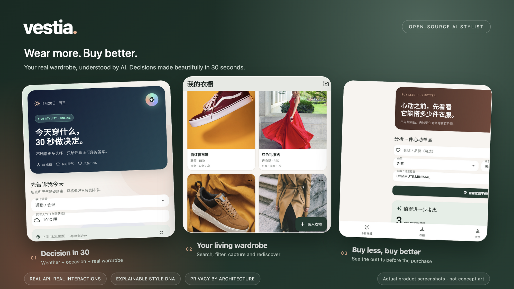
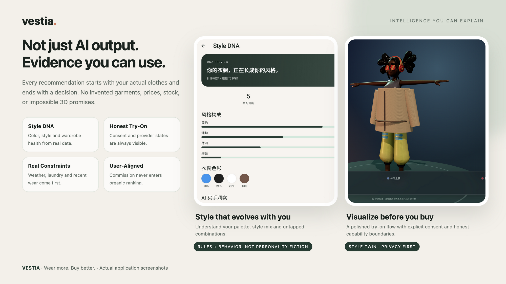

# Vestia

**Wear more. Buy better.**

> May 2026 · Open-source AI stylist

Vestia is an open-source, wardrobe-first AI styling assistant. It helps people decide what to wear, rediscover clothes they already own, understand their evolving style, and make better purchase decisions.

The product is designed around a simple belief: **an AI stylist should work for the user, not for a marketplace's GMV.**



Explore the [complete visual product tour](docs/SHOWCASE.md) with real application screenshots and interaction details.

## Signature experiences

- **Decision in 30**: combine weather, occasion, wardrobe state, and recent wear history to produce actionable outfits with evidence-based explanations.
- **Style DNA**: turn real wardrobe attributes and wear behavior into an explainable style profile, color palette, wardrobe health score, and utilization insights.
- **Wardrobe-first AI**: recommendations can only contain real items owned by the user. The LLM may explain a decision, but cannot invent clothes, prices, stock, or facts.
- **Buy less, buy better**: evaluate a potential purchase by how many real outfits it unlocks. Virtual try-on and cross-platform shopping are isolated behind provider interfaces and explicit quality gates.
- **Privacy by architecture**: user-scoped data access, private image storage, separate consent domains, and deletion are part of the core design rather than an afterthought.



## Current implementation

The repository currently contains a working vertical slice:

- Flutter application for iOS, Android, and Web.
- Spring Boot API with JPA persistence and a local H2 development profile.
- Wardrobe image upload, user-scoped image access, editing, laundry/archive states, and deletion.
- Eight locally bundled, manually reviewed real clothing photographs with automatic backfill for earlier demo data.
- Asynchronous recognition tasks with a deterministic dominant-color baseline. Unknown attributes remain unknown instead of being hallucinated.
- Automatic local weather through location permissions and Open-Meteo, with an explicitly labeled Shanghai fallback.
- Rule-based outfit generation with availability, recent-wear, weather, occasion, and category constraints.
- Outfit adoption and skip feedback with wear-count updates.
- Style DNA with color/style distributions, outfit potential, health scoring, and explainable insights.
- Purchase-gap analysis with persisted history and real compatible wardrobe items.
- Real-time Three.js digital-human rendering with 360° orbit/zoom, three garment types, and color switching on a clearly labeled demo avatar.
- Explicit provider registry and a consent-gated AI photo try-on flow that never fabricates unavailable results.
- Local development storage and optional PostgreSQL/Redis/RabbitMQ infrastructure definitions.

The following modules belong to the product roadmap and must not be misrepresented as complete: production multimodal recognition, photorealistic VTON, high-fidelity avatars, universal 3D garment reconstruction, production authentication, subscriptions, live marketplace data, and CPS settlement.

See the [technical design](docs/ARCHITECTURE.md) and [open-source research](docs/OPEN_SOURCE_RESEARCH.md) for implementation boundaries and license constraints.

## Repository layout

```text
apps/mobile/             Flutter application
services/api/            Spring Boot business API
packages/                Shared contracts and future viewer packages
infra/                   Optional local infrastructure
scripts/                 Development commands
docs/                    English product and engineering documentation
```

## Quick start

### Prerequisites

- JDK 21
- Flutter 3.50 or later
- Optional: Docker for PostgreSQL, Redis, and RabbitMQ

### Start the API

```bash
./scripts/dev-api.sh
```

The API listens on `http://127.0.0.1:8080`. It uses H2 and local private file storage by default, so Docker is not required for the first run.

### Start the Flutter application

```bash
flutter pub get --directory apps/mobile
./scripts/dev-mobile.sh
```

The default target is Chrome. To use another device:

```bash
DEVICE=<device-id> AISHOP_API_URL=http://127.0.0.1:8080 ./scripts/dev-mobile.sh
```

For the Android emulator, the API host is usually `http://10.0.2.2:8080`.

### Verify builds

```bash
make api-build
make mobile-analyze
make mobile-build
```

## Core API

| Method | Endpoint | Purpose |
|---|---|---|
| POST | `/api/v1/wardrobe/items` | Upload or manually create a wardrobe item |
| GET | `/api/v1/wardrobe/items` | List the current user's wardrobe |
| PUT | `/api/v1/wardrobe/items/{id}` | Correct attributes or change item state |
| DELETE | `/api/v1/wardrobe/items/{id}` | Delete an item and its image |
| GET | `/api/v1/tasks/{id}` | Poll an asynchronous recognition task |
| POST | `/api/v1/outfits/recommendations` | Generate constrained outfit recommendations |
| POST | `/api/v1/outfits/recommendations/{id}/feedback` | Adopt or skip an outfit |
| GET | `/api/v1/style-profile/current` | Get explainable Style DNA |

The default development profile uses a demo user. The PostgreSQL profile disables demo fallback and expects identity from the authentication layer; it is not a production authentication implementation.

## Engineering principles

1. Deterministic systems own constraints and facts; generative models assist perception and expression.
2. No empty AI promises. Unsupported or unconfigured providers return honest states.
3. Every AI result carries provenance, confidence, and a model or rule version.
4. Commercial fields never enter the organic recommendation score.
5. Code, model weights, training datasets, and body assets require separate license review.
6. Research-only models are isolated from production builds and real user photos.

## Documentation

- [Visual product tour](docs/SHOWCASE.md)
- [Product vision and experience principles](docs/PRODUCT.md)
- [Architecture and delivery plan](docs/ARCHITECTURE.md)
- [API guide](docs/API.md)
- [GitHub and model research](docs/OPEN_SOURCE_RESEARCH.md)
- [Asset licenses and provenance](docs/ASSET_LICENSES.md)
- [Roadmap and delivery gates](docs/ROADMAP.md)
- [Contributing](CONTRIBUTING.md)
- [Security policy](SECURITY.md)

The original Chinese PRD and detailed analysis are retained in the repository for traceability.

## License

Vestia's original source code is licensed under [Apache License 2.0](LICENSE).

Third-party frameworks, models, weights, datasets, textures, and body assets remain under their own licenses. In particular, IDM-VTON, OOTDiffusion, CatVTON, and the default SMPL-X license must not be treated as commercially cleared dependencies.
