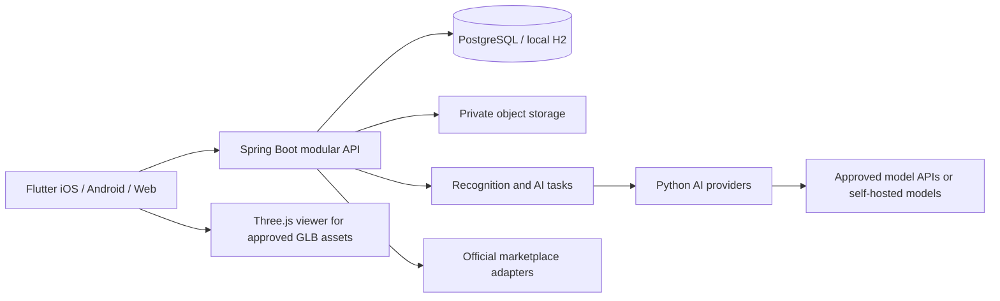

# Vestia Architecture

## System shape

Vestia uses a modular business monolith and independently scalable AI workers. This keeps early product iteration simple without coupling CPU business traffic to GPU inference.



## Modules

- Identity and consent
- Wardrobe and media
- Recognition tasks
- Style profiles
- Outfit recommendations and wear events
- Try-on and avatars
- Products, offers, and affiliate attribution
- Subscriptions and entitlements
- Operations and evaluation

## Recommendation pipeline

```text
User and weather context
  → Hard-constraint filtering
  → Outfit candidate generation
  → Personalized ranking
  → Diversity re-ranking
  → Fact-grounded explanation
  → Feedback and real-wear outcome
```

Large language models do not query arbitrary tables or invent recommendation candidates. They receive validated facts through narrow tools and produce structured output that is checked before persistence.

## AI provider boundaries

Recognition, VTON, avatar reconstruction, and marketplace integrations use versioned provider interfaces. A provider can be:

- `APPROVED`: allowed in production for a specific task and region.
- `RESEARCH_ONLY`: isolated evaluation with no real user photos.
- `BLOCKED`: prohibited by license, quality, privacy, or cost.
- `PENDING`: not yet verified.

Code licenses do not automatically clear model weights, datasets, body assets, or generated output.

## Data ownership

Every personal row and cache entry is user-scoped. Image access validates both ownership and normalized storage paths. Vector metadata is not treated as a sufficient authorization boundary.

Deletion must cover source images, thumbnails, embeddings, avatars, generated results, caches, and deletable provider copies.

## Local development

The default profile uses H2 and a local private storage directory so contributors can run the core workflow without Docker. PostgreSQL, Redis, and RabbitMQ definitions are provided in `infra/compose.yml` for integration work. Production profiles require migrations, managed secrets, real authentication, approved object storage, and explicit provider configuration.

## Delivery gates

- Recognition: representative frozen datasets, field-level accuracy, correction rate, latency, and cost.
- Recommendations: zero hard-constraint violations, diversity, explanation consistency, adoption, and wear outcomes.
- Try-on: identity preservation, garment fidelity, multi-view consistency where applicable, task success, GPU cost, and honest visual disclaimers.
- 3D: real GLB input, mobile frame rate, memory, thermal behavior, and asset optimization.
- Marketplace: source provenance, offer freshness, same-product precision, idempotent callbacks, and commission isolation.

## Detailed source documents

The Chinese system-analysis and GitHub research documents remain in the repository as detailed design history. New contributor-facing documentation is written in English.
