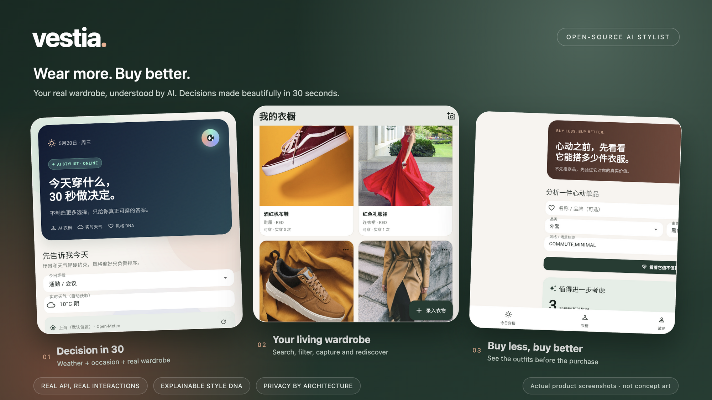

# Vestia Product Vision

> Product snapshot: May 2026

See the [visual product tour](SHOWCASE.md) for real application screenshots and detailed interaction flows.



## Purpose

Vestia answers three everyday questions:

1. What do I already own?
2. What should I wear today?
3. Should I buy this new item at all?

Most wardrobe applications stop at cataloging. Most shopping assistants optimize transactions. Vestia connects wardrobe understanding, personal style, visual confirmation, and purchase reasoning while remaining aligned with the user.

## Product principles

### Wardrobe before marketplace

The primary recommendation space is the user's real wardrobe. A marketplace item is introduced only when it fills a measurable gap or unlocks useful combinations.

### Evidence before fluency

A polished explanation is not evidence. Recommendations must preserve the weather snapshot, item IDs, rule/model versions, feedback, and wear outcomes needed to reproduce and evaluate a decision.

### Progress over forced completeness

A five-item wardrobe produces a clearly labeled preview. Twenty items unlock a fuller profile. Missing brands, fabrics, prices, or historical data remain empty instead of being fabricated.

### Visual reference is not fit prediction

Two-dimensional image editing, multi-view generation, and physical garment simulation are different capabilities. Vestia must describe each result accurately and never imply guaranteed fit from a generated image.

## North-star journey

```text
Capture clothes
  → Understand the wardrobe
  → Generate three executable outfits
  → Confirm, replace, or skip
  → Record real wear and learn
  → Identify genuine gaps
  → Analyze, visualize, buy, or walk away
```

## Signature feature: Decision in 30

The morning flow is optimized for a decision rather than engagement time:

1. The app already knows the user's wardrobe and recent wear.
2. Weather and occasion become hard constraints.
3. Three diverse outfits are generated from available items.
4. Each outfit includes concrete reasons and supports item-level replacement.
5. Adoption updates wear history and future recommendations.

## Signature feature: Style DNA

Style DNA combines explicit preferences, wardrobe distributions, color preferences, and real behavior. Its output includes:

- Style and color distributions.
- Category coverage and potential outfit combinations.
- Wear utilization and dormant-item opportunities.
- A rule-versioned wardrobe health score.
- Evidence-based wardrobe gaps.

The profile is a preference model, not a personality assessment.

## Signature feature: Buy less, buy better

A shopping decision should answer:

- How many valid outfits does this item unlock?
- Which existing items does it complement?
- Is it the same product or merely a similar product?
- Are price and inventory current, and where did they come from?
- Is a visual try-on available, and what are its limitations?
- Should the user buy, wait, or walk away?

Commission is never an input to organic ranking.

## Experience language

Vestia uses a calm editorial aesthetic rather than a dense administration console:

- Warm neutral surfaces, deep botanical tones, and restrained coral accents.
- Large decision cards with strong hierarchy and minimal morning cognitive load.
- Progressive disclosure for technical details and provenance.
- Optimistic interaction only for reversible local actions; AI tasks always expose real state.
- Empty states teach the next valuable action instead of displaying generic placeholders.

## Release strategy

### MVP

Wardrobe capture and correction, outfit decisions, wear feedback, Style DNA, privacy foundations, and evaluation infrastructure.

### V1

Production recognition, 2D visual try-on, calibrated avatars, subscriptions, and true 3D viewing for approved GLB assets.

### V2

Official marketplace integrations, product normalization, price history, purchase analysis, and CPS reconciliation.

Universal single-image 3D garment reconstruction is a research track, not a release promise.
