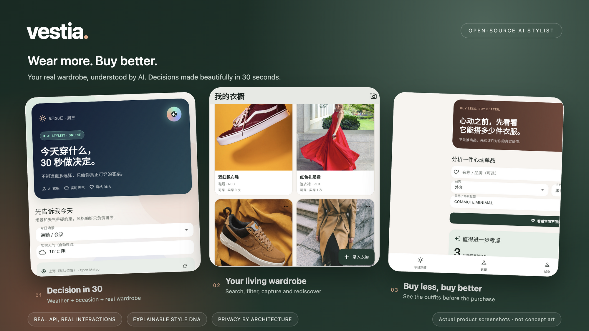
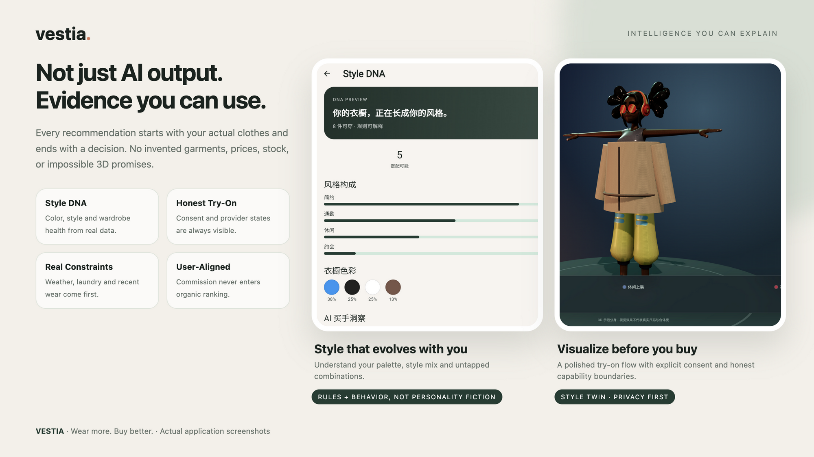
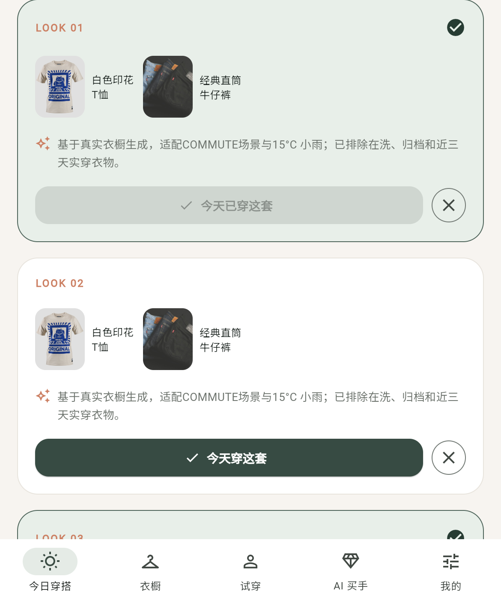
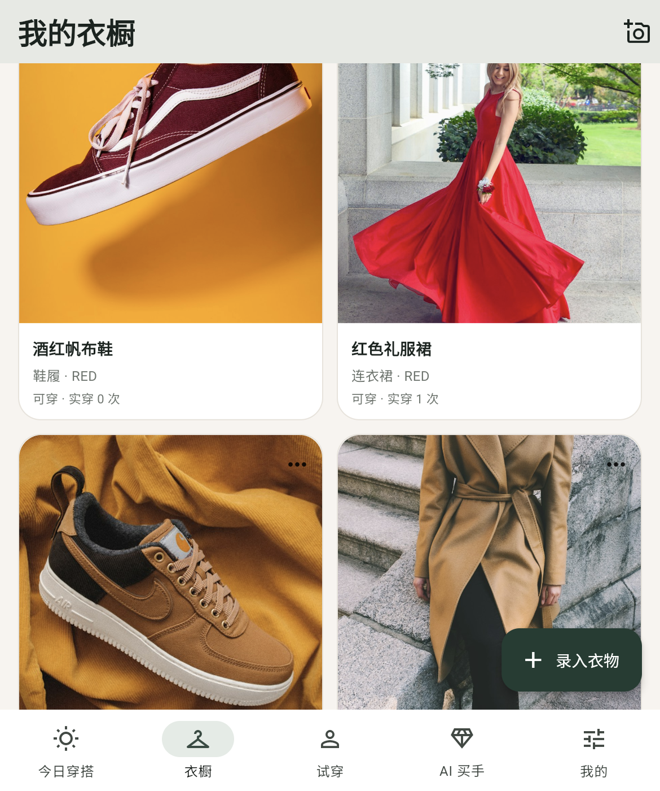
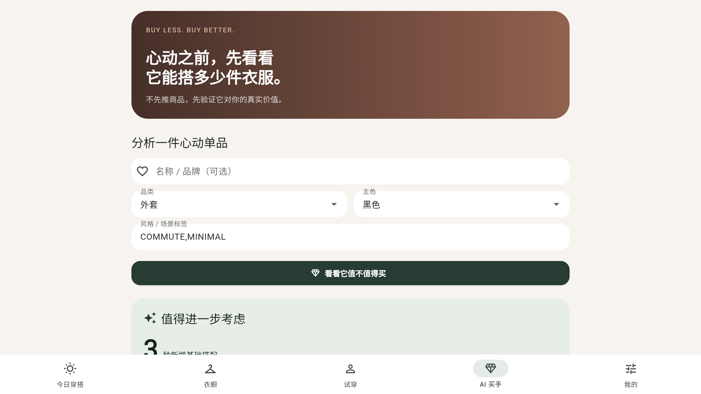
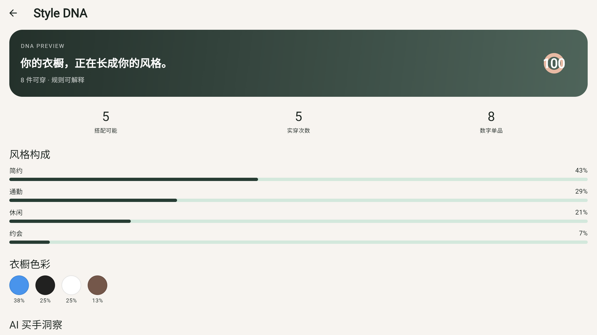
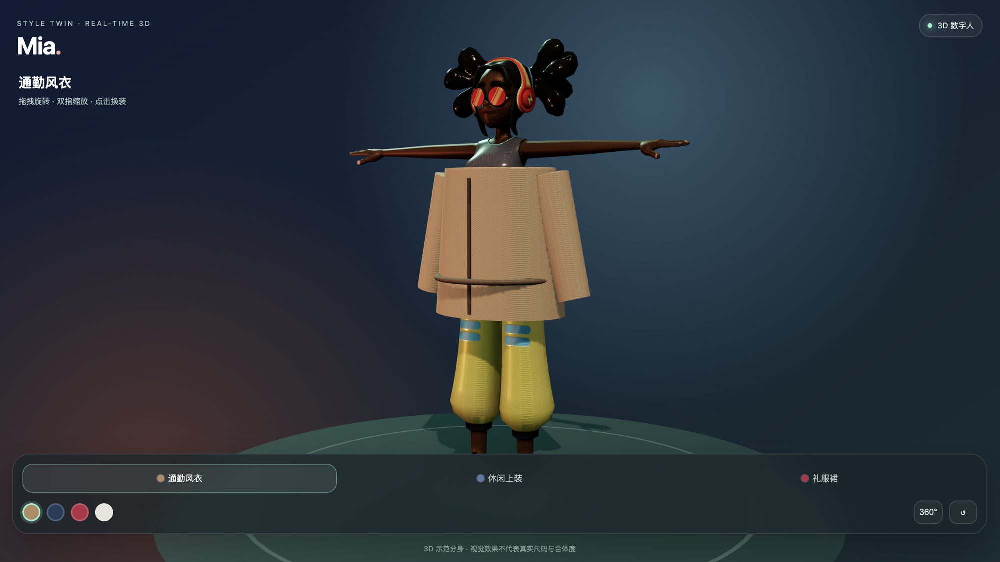

# Vestia Product Showcase

These are screenshots of the running application, captured after real API and browser interactions. They are not concept designs.

## Wear more. Buy better.

Vestia connects three experiences that are usually separated: a living digital wardrobe, fast daily outfit decisions, and purchase analysis grounded in the clothes a user already owns.

## Intelligence you can explain

The product makes its boundaries visible. Deterministic rules handle facts and constraints, providers declare their real status, and unavailable capabilities never return fabricated output.

## 1. Decision in 30

**What it does**

- Combines occasion, weather, real wardrobe state, and recent wear history.
- Produces up to three diverse outfits from clothes the user actually owns.
- Explains the concrete context behind each recommendation.
- Offers quick weather presets and a focused, low-cognitive-load morning flow.

**Interaction**

Choose an occasion, adjust weather, tap **Generate**, compare looks, then adopt or skip. Adoption updates real wear counts and influences subsequent recommendations.

## 2. A decision that becomes learning

An adopted outfit is visually confirmed and persisted. Repeating the same adoption does not inflate wear counts. Recently worn items are handled by the next recommendation cycle rather than being suggested again blindly.

## 3. A living, searchable wardrobe

**What it does**

- Displays real clothing photography in a responsive visual grid, with no hanger-only placeholders in the demo wardrobe.
- Bundles eight reviewed garment photos locally and automatically backfills earlier demo records without losing wear history.
- Searches names, colors, and style tags.
- Filters by category and exposes available, laundry, and archived states.
- Shows item-level wear counts and potential base combinations.
- Supports photo upload, manual correction, category changes, and deletion.

The interface is designed for rediscovery, not inventory administration: users can immediately see how much of their wardrobe is available and how many combinations it can unlock.

## 4. AI Buyer — Buy less, buy better

Before recommending a purchase, Vestia asks a more useful question: **what will this item unlock in your existing wardrobe?**

The analysis returns:

- Estimated new base outfits.
- Real compatible items as evidence.
- A strong-match, potential-match, or low-priority result.
- A persistent analysis history.
- A clear algorithm version and capability disclaimer.

Live marketplace prices, stock, historical lows, and commission data are shown only when official providers are configured. The application does not invent a “lowest price.”

## 5. Style DNA

Style DNA turns real wardrobe data into:

- Style and color distributions.
- Available-item and potential-outfit metrics.
- Real-wear counts.
- A rule-versioned wardrobe health score.
- Actionable insights for underused items and category gaps.

The profile is explicitly a preference model, not a personality assessment. Five items unlock a preview; twenty items unlock the fuller profile.

## 6. Style Twin try-on

The try-on journey now includes a real-time Three.js digital human with 360° orbit and zoom, three selectable garment types, and color switching. It also provides two photo pickers, independent image-processing consent, provider status, and clear visual-versus-fit guidance.

**Current boundary:** the GLB model and geometric garments are a demo digital human, not a personalized body scan or physical fit simulation. The repository does not ship a production VTON model. Without an approved adapter, AI-photo-try-on images are not uploaded and no fake result is generated.

Two-dimensional image editing, multi-view generation, and physical 3D garment simulation remain separate capabilities in the product language and architecture.

## Interaction design principles

- **Calm editorial visual language:** warm neutral surfaces, deep botanical green, restrained coral accents, and generous whitespace.
- **Decision-first hierarchy:** the next valuable action is always visually dominant.
- **Responsive layouts:** phone-friendly cards expand into centered, readable desktop experiences.
- **Real task feedback:** loading, degradation, adoption, errors, and unconfigured providers have distinct states.
- **No dark patterns:** users can skip, correct, delete, or walk away from a purchase.

## Verification behind the screenshots

The captured flows were exercised against the real Spring Boot API and Flutter Web build, including outfit generation, adoption, AI Buyer analysis, provider inspection, wardrobe rendering, and try-on preview behavior. Flutter static analysis, the Web release build, and backend compilation all pass in the documented development environment.
